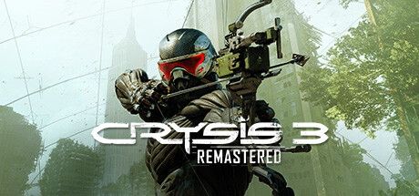

**Crysis 3 Remastered is the final chapter of the Nanosuit trilogy, set in a futuristic Liberty Dome New York filled with overgrown urban environments. Features the lethal Predator Bow alongside Nanosuit powers for the most varied combat in the series.**

---

## 📖 About

Crysis 3 Remastered is the final chapter of the Nanosuit trilogy, set in a futuristic Liberty Dome New York filled with overgrown urban environments. Features the lethal Predator Bow alongside Nanosuit powers for the most varied combat in the series.

## ⚠️ Problems Without Trainer

| Problem | Status |
|---------|--------|
| **Resource Depletion** — Nanosuit energy drains rapidly; managing power mode use is critical | ✅ Solved |
| **Alien Combat** — Ceph Alpha enemies in final chapters have high health and lethal attacks | ✅ Solved |
| **Predator Bow Ammo** — Bow ammo is scarce; misses are very costly on higher difficulties | ✅ Solved |
| **Short Campaign** — Main story is only 5-6 hours before the game ends | ✅ Solved |

## ✅ Solution

The **Crysis 3 Remastered Trainer** solves all these issues by giving you complete control over the game.

## 🎯 Full Feature List

- Unlimited Resources
- God Mode / Invincibility
- Instant Skill Cooldown
- One-Hit Kill
- Freeze Game Timer
- Unlock All Items & Achievements
- Custom Speed Multiplier
- Save State Anywhere

## 🚀 Quick Start

1. **Disable Windows Defender** temporarily (trainer may trigger false positive)
2. Download the trainer from the button above
3. Launch Crysis 3 Remastered
4. Run the trainer as Administrator
5. Activate desired cheats with hotkeys

## 💎 Free vs Paid

| Feature | Free | Pro |
|---------|------|-----|
| Basic God Mode | ✅ | ✅ |
| Unlimited Resources | ✅ | ✅ |
| All Advanced Cheats | ❌ | ✅ |
| Auto-Updates | ❌ | ✅ |
| Priority Support | ❌ | ✅ |

## 💻 Requirements

- Windows 10/11 (64-bit)
- Crysis 3 Remastered (any version)
- .NET Framework 4.8+
- DirectX 11+

## 🍎 macOS

macOS users can use our alternative tool:

## ⚖️ Legal

This trainer is for educational and single-player use only. Use responsibly.

---

